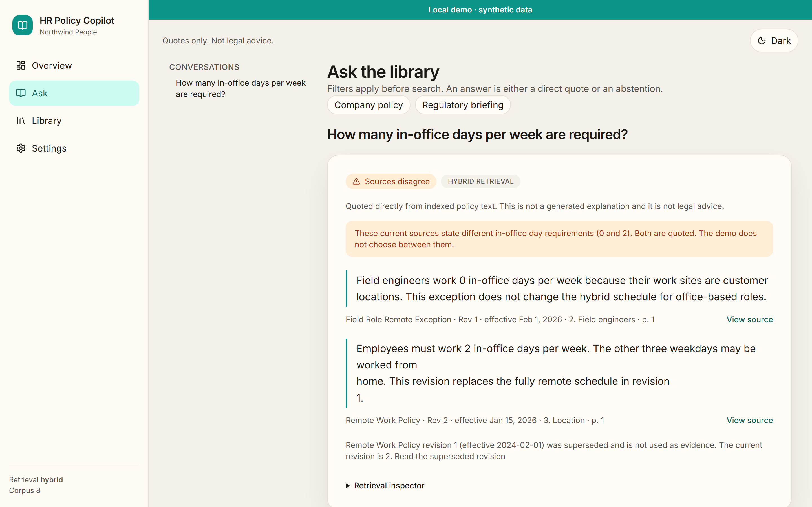
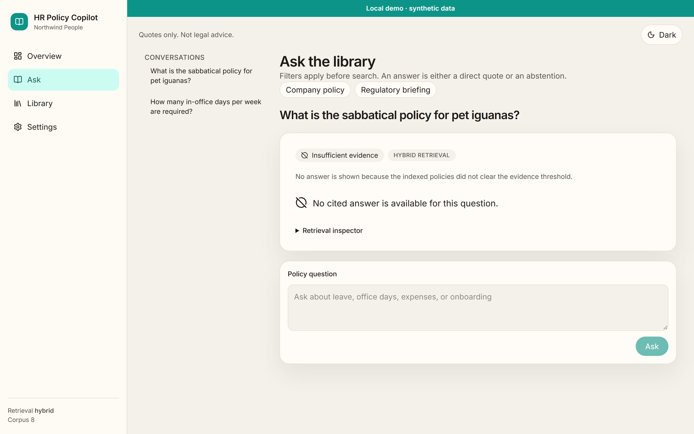
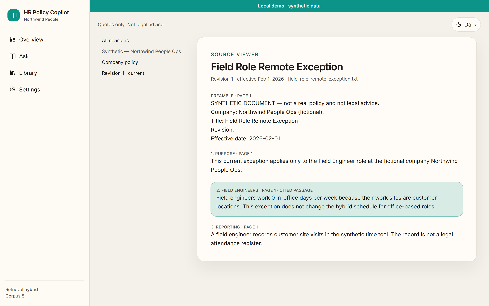
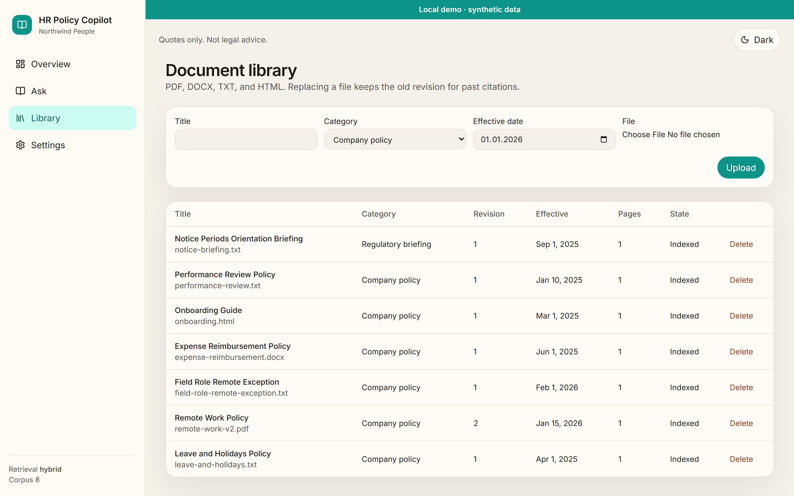
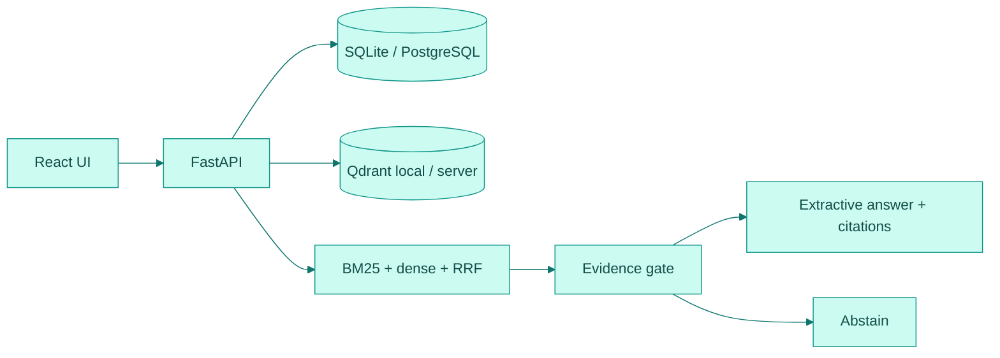
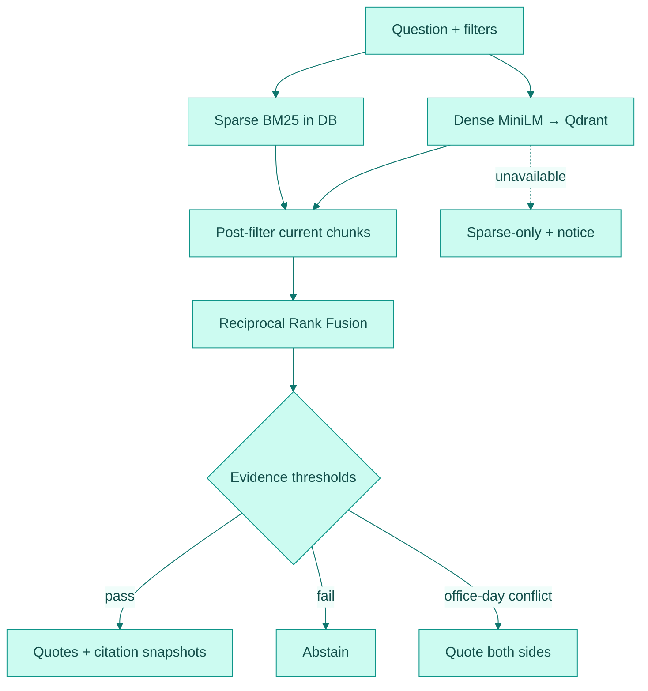

<a id="readme-top"></a>

<div align="center">

<picture>
  <source media="(prefers-color-scheme: dark)" srcset="docs/assets/banner-dark.svg">
  
</picture>

[](https://github.com/hasanhuseyinyetkiner/hr-policy-copilot/actions/workflows/ci.yml)

**Ask HR policy questions. Get answers you can verify.**

Evidence-first assistant for approved HR policies: hybrid BM25 + dense retrieval with Reciprocal Rank Fusion, versioned sources, extractive citations, and honest abstention — offline by default, no paid API keys.

[Overview](#executive-overview) · [Demo](#product-demonstration) · [Architecture](#system-architecture) · [Deep dive](#engineering-deep-dive) · [Evaluation](#evaluation-and-evidence) · [Quick start](#getting-started) · [Docs](#documentation)

</div>

---

## Executive overview

| Dimension | Description |
| --- | --- |
| **Business challenge** | Employees and HR partners need answers from *approved* policy text. Chat-style assistants invent rules, mix obsolete revisions, or stay silent about conflicts. |
| **Proposed solution** | A local library + Ask UI that retrieves current chunks, quotes exact passages with revision metadata, surfaces disagreements, and abstains when evidence is weak. |
| **Primary users** | HR ops / people partners evaluating policy tooling; engineers reviewing retrieval system design. Demo audience uses synthetic “Northwind People” policies. |
| **Engineering challenge** | Keep sparse and dense indexes consistent with a versioned relational source of truth; refuse to cite stale or weak evidence; survive hostile uploads. |
| **Architecture** | React + Vite UI · FastAPI · SQLite (native) / PostgreSQL (Compose) · Qdrant · MiniLM dense embeddings · DB-backed BM25 · RRF fusion |
| **Validation** | 31 backend pytest cases; Vitest + Playwright smoke/screenshots; labeled eval on n=11 synthetic questions (hash fixture + MiniLM-on-seed — see Evaluation) |
| **Project status** | Local **MVP / demo**. Not a multi-user production SaaS. License pending owner decision. |

---

## Product demonstration

Captures from a live local run (`pnpm screenshots` → API `8101` + web `5101`). Light/dark pairs in [`docs/screenshots/`](docs/screenshots/).

### 1. Cited answer when sources disagree

Ask: *How many in-office days per week are required?* → both current policies are quoted; superseded Rev 1 is excluded from evidence.

<p align="center">
  <picture>
    <source media="(prefers-color-scheme: dark)" srcset="docs/screenshots/answer-dark.png">
    
  </picture>
</p>

### 2. Abstention when evidence is insufficient

Ask: *What is the sabbatical policy for pet iguanas?* → explicit abstention; no invented policy.

<p align="center">
  <picture>
    <source media="(prefers-color-scheme: dark)" srcset="docs/screenshots/abstain-dark.png">
    
  </picture>
</p>

### 3. Source viewer + library

Jump from a citation into the highlighted passage; browse the seeded synthetic corpus (Indexed state).

<p align="center">
  <picture>
    <source media="(prefers-color-scheme: dark)" srcset="docs/screenshots/source-dark.png">
    
  </picture>
  &nbsp;
  <picture>
    <source media="(prefers-color-scheme: dark)" srcset="docs/screenshots/library-dark.png">
    
  </picture>
</p>

### 60-second walkthrough

With seed data (`SEED_ON_STARTUP=true` or **Settings → Reset demo**):

1. **Leave** — *How many days of annual leave do employees get?* → quote containing **25 days of annual leave** from *Leave and Holidays Policy*, with View source.
2. **Abstain** — iguana question above → Insufficient evidence.
3. **Conflict** — in-office days → Sources disagree; app does not pick a winner.
4. Optional — open Retrieval inspector for BM25 / dense / RRF breakdown on a cited answer.

<details>
<summary><strong>API sketch</strong> — seeded leave question</summary>

```powershell
curl -s http://127.0.0.1:8101/api/query `
  -H "Content-Type: application/json" `
  -d "{\"question\":\"How many days of annual leave does a full-time employee receive?\"}"
```

Expect JSON with an evidence-backed message whose citation snippet contains `25 days of annual leave`. OpenAPI: http://127.0.0.1:8101/docs

</details>

---

## Problem and engineering approach

**Problem.** Policy chatbots that generate unconstrained prose fail the HR trust bar: no provenance, silent revision drift, and confident answers to questions the corpus cannot support.

**Why naive alternatives fall short**

| Approach | Failure mode |
| --- | --- |
| Keyword search only | Misses paraphrase; no citation UX discipline |
| Dense RAG + free-form LLM | Fluent hallucinations; hard to audit |
| Single unversioned index | Obsolete clauses remain citeable after replace |
| Always answer | Invents leave/expense/remote rules under pressure |

**Chosen approach.** Treat retrieval as a **gated extractive pipeline**: parse safely → index terms + vectors keyed to corpus version → fuse with RRF → post-filter against current DB rows → quote or abstain. Optional generative grounding is explicitly **not** in the MVP.

**Deliberately not solved here:** multi-user auth, production multi-tenant isolation, general NLI contradiction detection beyond the demo office-day detector, or certified legal/compliance advice.

---

## System architecture



### Retrieval pipeline (code-faithful)



1. Parse uploads in a subprocess with caps; chunk by section/page.
2. Index BM25 term statistics in PostgreSQL/SQLite (`corpus_version`) and vectors in Qdrant.
3. Query: validate → category/audience filters → sparse + dense → RRF → evidence gate → quote, conflict display, or abstain.
4. Citations store snippet + sha256 + `document_version_id` so past answers survive supersede.

Embedding model for the live demo: `sentence-transformers/all-MiniLM-L6-v2` (Apache-2.0), CPU torch via `[[tool.uv.index]]` pytorch-cpu. Full component notes: [`docs/ARCHITECTURE.md`](docs/ARCHITECTURE.md).

---

## Engineering deep dive

Five decisions that define the system. Full Context → Options → Decision → Trade-offs → Validation write-ups: [`docs/ENGINEERING_DECISIONS.md`](docs/ENGINEERING_DECISIONS.md).

| # | Decision | Why it matters | Trace |
| --- | --- | --- | --- |
| 1 | **Hybrid BM25 + dense + RRF** | Exact phrases and paraphrases without score-scale calibration | `services/retrieval.py`, `domain/fusion.py` |
| 2 | **DB post-filter on every hit** | Vectors never override current policy state | `post_filter_chunks`, HR-1 tests |
| 3 | **Soft versioning + citation snapshots** | Past answers remain auditable after PDF replace | `services/answering.py`, HR-4 |
| 4 | **Extractive gate + abstention** | No unconstrained HR prose; conflicts quoted both ways | `domain/evidence.py` |
| 5 | **Hostile parse sandbox** | Timeout, zip-bomb, unterminated PDF image fail closed | `parsing/sandbox.py`, HR-3 |

Also: degraded sparse-only mode when MiniLM/Qdrant is down (`/ready` → `degraded`) — see decision 6 in the long-form doc.

---

## Evaluation and evidence

Labeled questions: `data/eval/questions.jsonl` (**n=11** synthetic). Metrics: Recall@4, MRR, citation precision, snippet sha256 faithfulness, abstention accuracy. Modes: `hybrid` (BM25+dense+RRF), `dense`, `sparse` (BM25-only). Full method: [`docs/EVALUATION.md`](docs/EVALUATION.md).

### Hash fixture (deterministic unit-test embedder)

Used by default in `scripts/run_eval.py` and pytest. Perfect scores on this tiny seed are **expected** — they validate wiring, not production RAG quality.

```powershell
cd backend
uv run python ../scripts/run_eval.py
```

| Mode | Recall@4 | MRR | Citation precision | Faithfulness | Abstention accuracy |
| --- | --- | --- | --- | --- | --- |
| hybrid | 1.00 | 1.00 | 1.00 | 1.00 | 1.00 |
| dense | 1.00 | 1.00 | 1.00 | 1.00 | 1.00 |
| sparse | 1.00 | 1.00 | 1.00 | 1.00 | 1.00 |

Raw: [`docs/EVAL_RESULTS.json`](docs/EVAL_RESULTS.json) · table: [`docs/EVAL.md`](docs/EVAL.md).

### Local MiniLM-on-seed (demo embedder)

Same n=11 labels with `sentence-transformers/all-MiniLM-L6-v2` (`--backend local`). Measured `2026-10-20T15:33:03Z` on Windows 11 / CPU torch / `models/all-MiniLM-L6-v2`. Shows the **demo corpus is solvable** with the live stack; **not** a held-out enterprise benchmark. On this seed, modes do not separate — a corpus-size limit, not a hybrid≫dense proof.

```powershell
cd backend
uv run python ../scripts/run_eval.py --backend local
```

| Mode | Recall@4 | MRR | Citation precision | Faithfulness | Abstention accuracy |
| --- | --- | --- | --- | --- | --- |
| hybrid | 1.00 | 1.00 | 1.00 | 1.00 | 1.00 |
| dense | 1.00 | 1.00 | 1.00 | 1.00 | 1.00 |
| sparse | 1.00 | 1.00 | 1.00 | 1.00 | 1.00 |

Raw: [`docs/EVAL_RESULTS_MINILM.json`](docs/EVAL_RESULTS_MINILM.json) · table: [`docs/EVAL_MINILM.md`](docs/EVAL_MINILM.md).

**Still missing (not invented):** a held-out or multi-corpus hybrid-vs-dense study with human-rated answer quality.

### Automated tests

Verified locally on 2026-10-20:

```text
cd backend && uv run pytest -q
# 31 passed  (19 api + 11 domain + 1 health-responsive)
```

```powershell
cd backend; uv run ruff check .; uv run pytest -q
cd frontend; pnpm lint; pnpm typecheck; pnpm test; pnpm build
cd frontend; pnpm e2e          # Playwright: seeded ask + upload→index→cite
cd frontend; pnpm screenshots  # writes docs/screenshots/*.png
```

CI (GitHub Actions): backend Ruff + pytest against PostgreSQL, frontend lint / `tsc` / Vitest / build, `compose-smoke`. Badge above tracks [`.github/workflows/ci.yml`](.github/workflows/ci.yml).

---

## Engineering competencies demonstrated

| Competency | Implementation evidence |
| --- | --- |
| Retrieval system design | Hybrid BM25 + dense + RRF pipeline — [`retrieval.py`](backend/app/services/retrieval.py), [`fusion.py`](backend/app/domain/fusion.py) |
| Data consistency / versioning | DB source of truth, soft supersede, citation snapshots — [`ENGINEERING_DECISIONS.md`](docs/ENGINEERING_DECISIONS.md) §§2–3 |
| Trustworthy AI product boundaries | Extractive answers, evidence thresholds, abstention, conflict display — [`evidence.py`](backend/app/domain/evidence.py), [`answering.py`](backend/app/services/answering.py) |
| Security-minded ingestion | Subprocess parse, zip-bomb / pathological PDF tests — [`sandbox.py`](backend/app/parsing/sandbox.py), [`hostile.py`](backend/app/parsing/hostile.py) |
| Reliability & operability | Degraded `/ready`, job reaper, reconcile script, loopback bind — [`SECURITY.md`](docs/SECURITY.md) |
| Verification | pytest + Playwright + labeled hash + MiniLM-on-seed eval — [`EVALUATION.md`](docs/EVALUATION.md) |
| Technical communication | Architecture, ADRs-style decisions, honest limitations in `docs/` |

---

## Getting started

> [!NOTE]
> Native path verified on Windows 11 with `uv` + `pnpm`. Docker Compose is present and verified in CI (`compose-smoke`); this authoring machine may not have Docker locally.

### Prerequisites

- Python 3.12 via `uv`
- Node.js + `pnpm`
- First-time model download into gitignored `models/` (or rely on hash backend for tests only)

### Run

```powershell
# Backend (API http://127.0.0.1:8101)
cd backend
uv sync
uv run python -m app.download_model   # first time only — or: make models
uv run python -m app

# Frontend (http://127.0.0.1:5101) — new terminal
cd frontend
pnpm install
pnpm dev
```

| Service | URL |
| --- | --- |
| Web | http://127.0.0.1:5101 |
| API docs | http://127.0.0.1:8101/docs |
| Health | http://127.0.0.1:8101/health |
| Ready | http://127.0.0.1:8101/ready |

Env vars: [`.env.example`](.env.example). Loopback bind by default (`ALLOW_NETWORK_BIND=true` required for non-loopback).

### Troubleshooting

| Symptom | Check |
| --- | --- |
| `/ready` degraded | Model path `MODEL_DIR`, `HF_HUB_OFFLINE`, Qdrant path lock |
| Empty library | **Settings → Reset demo** or `SEED_ON_STARTUP=true` |
| Port in use | Free `8101` / `5101` or stop prior `uv run` / `pnpm` processes |
| Upload FAILED | Hostile/size caps; see extraction error on the document |

<details>
<summary><strong>Repository layout</strong></summary>

```
backend/     FastAPI, SQLAlchemy, Alembic, retrieval, parsers, tests
frontend/    React + Vite + TanStack Query + Playwright
data/demo/   Synthetic policies + manifest.json
data/eval/   Evaluation questions (questions.jsonl)
scripts/     download_models, reconcile_index, run_eval
docs/        Architecture, decisions, evaluation, security, screenshots
compose.yaml web + api + postgres + qdrant (CI compose-smoke)
.github/     ci.yml — Ruff/pytest (Postgres), frontend lint/tsc/vitest/build, compose-smoke
```

</details>

---

## Security, privacy, and limitations

> [!IMPORTANT]
> Local demo · synthetic data. Loopback bind by default. Not legal advice. No multi-user auth in the MVP. Audience is a retrieval filter, not access control. Optional Ollama / cloud LLM grounding is **not wired** — MVP answers stay extractive.

| Topic | Stance |
| --- | --- |
| AuthN/AuthZ | None in MVP — do not expose beyond loopback |
| Real employee data | Do not upload; demo corpus is synthetic |
| Parsing threats | Subprocess + caps + zip-bomb / pathological PDF rejects |
| Employment decisions | Not implemented; human review required for any consequential use |
| License | Pending owner decision (no `LICENSE` file yet) |

Full write-up: [`docs/SECURITY.md`](docs/SECURITY.md).

### Feature status

| Status | Capability |
| --- | --- |
| **Shipped** | Hybrid retrieval: DB BM25 + MiniLM dense vectors, fused with RRF; DB post-filters every citeable hit |
| **Shipped** | Document library for PDF / DOCX / TXT / HTML with hostile-upload sandbox |
| **Shipped** | Ask UI with extractive quotes, citations, contradiction display, source viewer, version history |
| **Shipped** | Demo seed (≥5 synthetic policies + obsolete remote-work revision) and reset / delete-all |
| **Shipped** | Sparse-only fallback when embeddings or Qdrant are down |
| **Shipped** | Citations survive document replacement |
| **Roadmap** | Optional Ollama / cloud LLM grounding (not wired) |
| **Roadmap** | Multi-user authentication |
| **Roadmap** | License choice |

---

## Documentation

| Doc | Contents |
| --- | --- |
| [`docs/ARCHITECTURE.md`](docs/ARCHITECTURE.md) | Topology, retrieval pipeline, API surface |
| [`docs/ENGINEERING_DECISIONS.md`](docs/ENGINEERING_DECISIONS.md) | Long-form decision records |
| [`docs/EVALUATION.md`](docs/EVALUATION.md) | Metrics method, hash vs MiniLM, hybrid/dense/sparse |
| [`docs/EVAL.md`](docs/EVAL.md) / [`EVAL_RESULTS.json`](docs/EVAL_RESULTS.json) | Hash fixture numbers |
| [`docs/EVAL_MINILM.md`](docs/EVAL_MINILM.md) / [`EVAL_RESULTS_MINILM.json`](docs/EVAL_RESULTS_MINILM.json) | Measured MiniLM numbers |
| [`docs/SECURITY.md`](docs/SECURITY.md) | Threat boundaries and privacy |
| [`docs/RELEASE_READINESS.md`](docs/RELEASE_READINESS.md) | Portfolio release blockers checklist |
| [`docs/PRODUCT_SPEC.md`](docs/PRODUCT_SPEC.md) | Historical build brief (superseded by shipped code + amendments) |
| [`docs/REVIEW_AMENDMENTS.md`](docs/REVIEW_AMENDMENTS.md) | Binding design constraints (ports, HR-1…HR-5) |
| [`docs/GITHUB_METADATA.md`](docs/GITHUB_METADATA.md) | Private-release About text, topics (no OSS topic until licensed) |
| [`frontend/README.md`](frontend/README.md) | UI architecture, ports, screenshots, tests |

<p align="right"><a href="#readme-top">↑ back to top</a></p>
