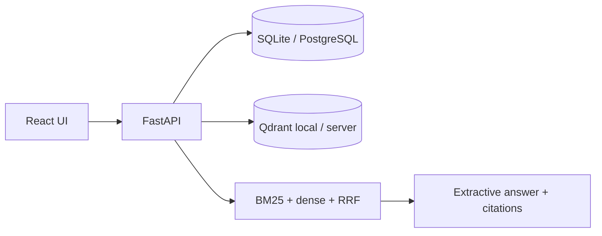

<a id="readme-top"></a>

<div align="center">

<picture>
  <source media="(prefers-color-scheme: dark)" srcset="docs/assets/banner-dark.svg">
  
</picture>

**Evidence-first HR policy assistant.** Upload approved policies, ask questions, and get extractive answers with exact citations — offline by default, no paid API keys required.

[Quick start](#quick-start) · [How it works](#how-it-works) · [Limitations](#security-privacy-and-limitations)

</div>

## Quick start

> [!NOTE]
> Native path verified on Windows 11 with `uv` + `pnpm`. Docker Compose is present but verified in CI only (no Docker on the authoring machine).

```powershell
# Backend (API http://127.0.0.1:8101)
cd backend
uv sync
uv run python -m app.download_model   # first time only
uv run python -m app

# Frontend (http://127.0.0.1:5101) — new terminal
cd frontend
pnpm install
pnpm dev
```

| Service | URL |
| --- | --- |
| Web | http://127.0.0.1:5101 |
| API docs | http://127.0.0.1:8101/docs |
| Health | http://127.0.0.1:8101/health |

Demo policies seed automatically. Ask: *How many days of annual leave do employees get?* — you should see an extractive answer with citation `[1]` linking to the source passage.

## How it works



PostgreSQL/SQLite is the source of truth for document versions; vector hits are post-filtered against current chunks. Hostile PDF/DOCX parsing runs under timeout. Embedding model: `all-MiniLM-L6-v2` (CPU torch).

## Testing

```powershell
cd backend; uv run pytest -q
cd frontend; pnpm test; pnpm build
```

## Security, privacy and limitations

> [!IMPORTANT]
> Local demo · synthetic data. Loopback bind by default. Not legal advice. No multi-user auth in the MVP.

License: pending owner decision.

<p align="right"><a href="#readme-top">↑ back to top</a></p>
