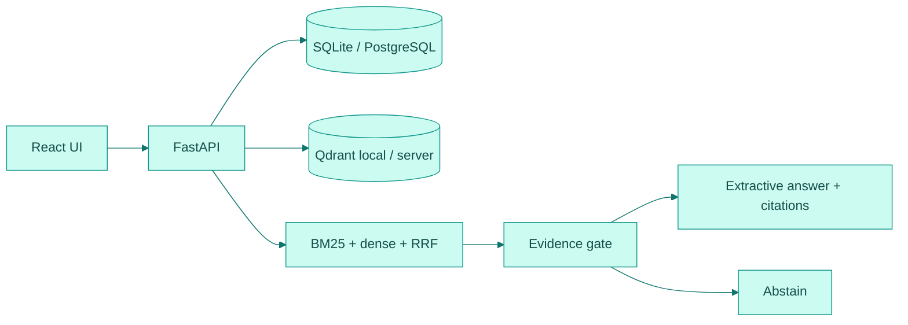

<a id="readme-top"></a>

<div align="center">

<picture>
  <source media="(prefers-color-scheme: dark)" srcset="docs/assets/banner-dark.svg">
  
</picture>

[](https://github.com/hasanhuseyinyetkiner/hr-policy-copilot/actions/workflows/ci.yml)

**Ask HR policy questions. Get answers you can verify.**

Evidence-first assistant for approved HR policies: hybrid retrieval, versioned sources, extractive citations, and honest abstention — offline by default, no paid API keys.

[Quick start](#quick-start) · [Demo](#60-second-demo) · [Features](#feature-status) · [How it works](#how-it-works) · [Testing](#testing) · [Docs](#documentation)

</div>

<br />

<p align="center">
  <picture>
    <source media="(prefers-color-scheme: dark)" srcset="docs/screenshots/answer-dark.png">
    
  </picture>
</p>

<p align="center">
  <picture>
    <source media="(prefers-color-scheme: dark)" srcset="docs/screenshots/library-dark.png">
    
  </picture>
  &nbsp;
  <picture>
    <source media="(prefers-color-scheme: dark)" srcset="docs/screenshots/source-dark.png">
    
  </picture>
</p>

Captures from a live local run (`pnpm screenshots` → API `8101` + web `5101`). Light/dark pairs in [`docs/screenshots/`](docs/screenshots/).

## Why this exists

| Before | After |
| --- | --- |
| Chatbots invent HR “rules” with no provenance | Answers are quoted passages with revision + effective date |
| Old PDFs linger in the index | Replacing a file supersedes vectors; past citations keep their snapshot |
| Silent failure when evidence is weak | Explicit abstention when nothing clears the evidence gate |

## Feature status

| Status | Capability |
| --- | --- |
| **Shipped** | Hybrid retrieval: DB BM25 + MiniLM dense vectors, fused with RRF; PostgreSQL/SQLite post-filters every citeable hit |
| **Shipped** | Document library for PDF / DOCX / TXT / HTML with hostile-upload sandbox (timeout, zip-bomb, unterminated PDF image) |
| **Shipped** | Ask UI with extractive quotes, inline citations, contradiction display, category filters, source viewer, version history |
| **Shipped** | Demo seed (≥5 synthetic policies + obsolete remote-work revision) and one-click reset / delete-all |
| **Shipped** | Sparse-only fallback when embeddings or Qdrant are down (`/ready` → `degraded`) |
| **Shipped** | Citations survive document replacement (snippet + sha256 + `document_version_id`) |
| **Roadmap** | Optional Ollama / cloud LLM grounding (MVP stays extractive; not wired) |
| **Roadmap** | Multi-user authentication (audience is a retrieval filter today, not access control) |
| **Roadmap** | License choice (README states pending; no `LICENSE` file yet) |

## Quick start

> [!NOTE]
> Native path verified on Windows 11 with `uv` + `pnpm`. Docker Compose is present and verified in CI (`compose-smoke`); this authoring machine has no Docker.

```powershell
# Backend (API http://127.0.0.1:8101)
cd backend
uv sync
uv run python -m app.download_model   # first time only — or: make models
uv run python -m app

# Frontend (http://127.0.0.1:5101) — new terminal
cd frontend
pnpm install
pnpm dev
```

| Service | URL |
| --- | --- |
| Web | http://127.0.0.1:5101 |
| API docs | http://127.0.0.1:8101/docs |
| Health | http://127.0.0.1:8101/health |
| Ready | http://127.0.0.1:8101/ready |

Env vars: [`.env.example`](.env.example). Loopback bind by default (`ALLOW_NETWORK_BIND=true` required for non-loopback).

## 60-second demo

With seed data loaded (`SEED_ON_STARTUP=true` or **Settings → Reset demo**):

1. Open **Ask** → *How many days of annual leave do employees get?*  
   Expect an extractive answer citing **25 days of annual leave** from *Leave and Holidays Policy*, with a `[1]` / View source link into the passage.
2. Ask *What is the sabbatical policy for pet iguanas?*  
   Expect abstention (no inventing).
3. Optional conflict check: *How many in-office days per week are required?*  
   Expect **Sources disagree** — Remote Work Policy (2 days) vs Field Role Remote Exception (0 days); the app does not pick a winner.

## How it works



1. Parse uploads in a subprocess with caps; chunk by section/page.
2. Index terms in PostgreSQL/SQLite (BM25 stats keyed by `corpus_version`) and vectors in Qdrant.
3. Query: validate → category/audience filters → sparse + dense → RRF → evidence thresholds → quote or abstain.
4. Citations store snippet + sha256 + `document_version_id` so past answers survive supersede.

Embedding model: `sentence-transformers/all-MiniLM-L6-v2` (Apache-2.0), CPU torch via `[[tool.uv.index]]` pytorch-cpu.

### Engineering deep-dive

Short notes; binding design constraints live in the docs linked below.

- **DB is source of truth** — every dense/sparse hit is post-filtered against current chunks before cite.
- **No unversioned BM25** — term stats (or FTS) keyed to `corpus_version`; rebuild when the corpus changes.
- **Hostile uploads** — parse timeout, page/size caps, zip-bomb DOCX reject, unterminated PDF image fail path.
- **Extractive MVP** — answers are stored passages, not free-form LLM prose.
- **Degraded mode** — missing model/Qdrant → `/ready` degraded + sparse-only with a UI notice.

<details>
<summary><strong>API example</strong> — ask a seeded leave question</summary>

```powershell
curl -s http://127.0.0.1:8101/api/query `
  -H "Content-Type: application/json" `
  -d "{\"question\":\"How many days of annual leave does a full-time employee receive?\"}"
```

Expect JSON with an evidence-backed message whose citation snippet contains `25 days of annual leave`. OpenAPI: http://127.0.0.1:8101/docs

</details>

<details>
<summary><strong>Repository layout</strong></summary>

```
backend/     FastAPI, SQLAlchemy, Alembic, retrieval, parsers, tests
frontend/    React + Vite + TanStack Query + Playwright
data/demo/   Synthetic policies + manifest.json
data/eval/   Evaluation questions (questions.jsonl)
scripts/     download_models, reconcile_index, run_eval
docs/        PRODUCT_SPEC, REVIEW_AMENDMENTS, EVAL, screenshots, assets
compose.yaml web + api + postgres + qdrant (CI compose-smoke)
.github/     ci.yml — Ruff/pytest (Postgres), frontend lint/tsc/vitest/build, compose-smoke
```

</details>

## Evaluation

Measured on the seeded synthetic corpus (`data/eval/questions.jsonl`) with the deterministic **hash** embedder used in unit tests. Re-run:

```powershell
cd backend
uv run python ../scripts/run_eval.py
```

Results: [`docs/EVAL.md`](docs/EVAL.md) / [`docs/EVAL_RESULTS.json`](docs/EVAL_RESULTS.json). Measured 2026-10-20 on **n=11** synthetic questions (not a MiniLM production benchmark — perfect scores on this tiny fixture are expected):

| Mode | Recall@4 | MRR | Citation precision | Faithfulness | Abstention accuracy |
| --- | --- | --- | --- | --- | --- |
| hybrid | 1.00 | 1.00 | 1.00 | 1.00 | 1.00 |
| dense | 1.00 | 1.00 | 1.00 | 1.00 | 1.00 |

Method: gold titles/snippets in the JSONL; faithfulness = `sha256(snippet)` match; abstention accuracy covers `abstain` + `ambiguous` rows; dense vs hybrid via `retrieval_preference`.

## Testing

Verified locally on 2026-10-20:

```text
cd backend && uv run pytest -q
# 31 passed
```

```powershell
cd backend; uv run ruff check .; uv run pytest -q
cd frontend; pnpm lint; pnpm typecheck; pnpm test; pnpm build
cd frontend; pnpm e2e          # Playwright: seeded ask + upload→index→cite
cd frontend; pnpm screenshots  # writes docs/screenshots/*.png
```

CI (GitHub Actions): backend Ruff + pytest against PostgreSQL, frontend lint / `tsc` / Vitest / build, `compose-smoke`. Badge above tracks [`.github/workflows/ci.yml`](.github/workflows/ci.yml).

## Security, privacy and limitations

> [!IMPORTANT]
> Local demo · synthetic data. Loopback bind by default. Not legal advice. No multi-user auth in the MVP. Audience is a retrieval filter, not access control. Optional Ollama / cloud LLM grounding is not wired — MVP answers stay extractive.

License: pending owner decision.

## Documentation

| Doc | Contents |
| --- | --- |
| [`docs/PRODUCT_SPEC.md`](docs/PRODUCT_SPEC.md) | Product concept and phase plan |
| [`docs/REVIEW_AMENDMENTS.md`](docs/REVIEW_AMENDMENTS.md) | Binding design constraints (ports, loopback, HR-1…HR-5) |
| [`docs/EVAL.md`](docs/EVAL.md) | Measured eval table + method |
| [`docs/GITHUB_METADATA.md`](docs/GITHUB_METADATA.md) | Suggested GitHub About text and topics |

<p align="right"><a href="#readme-top">↑ back to top</a></p>
