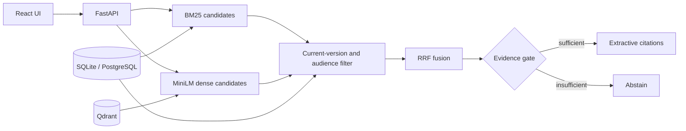

<a id="readme-top"></a>

<p align="center"></p>

# HR Policy Copilot

**Ask a policy question. Follow the evidence.**

A local, evidence-first assistant for a synthetic HR policy library. Hybrid retrieval finds relevant passages; answers quote their sources or abstain when evidence is insufficient.

[](https://github.com/hasanhuseyinyetkiner/hr-policy-copilot/actions/workflows/ci.yml)
[](LICENSE)

[Highlights](#highlights) · [Architecture](#architecture) · [Evaluation](#evaluation-and-testing) · [Quick start](#quick-start) · [Security & limitations](#security-privacy-and-limitations) · [Docs](#documentation)

<p align="center">
  <picture>
    <source media="(prefers-color-scheme: dark)" srcset="docs/screenshots/answer-dark.png">
    
  </picture>
</p>

*A local demo capture: two current sources disagree; the superseded revision is excluded from the answer.*

[Watch the real ask → answer → source workflow (GIF)](docs/assets/demo.gif). The static screenshot above is available without motion. To regenerate the recording, run `node scripts/record-demo.mjs` from the repository root after installing the project dependencies, local embedding model, Playwright Chromium and FFmpeg. Its output and isolated synthetic data remain in the printed temporary folder; see the [script](scripts/record-demo.mjs) for options.

## Highlights

- **Find evidence across wording.** Database-backed BM25 and MiniLM embeddings in Qdrant are combined with Reciprocal Rank Fusion (RRF).
- **Keep revisions in view.** The relational database checks candidate chunks against current document versions; citation snapshots preserve the passage and revision used in an earlier answer.
- **Quote, surface conflict, or abstain.** An evidence gate selects extractive passages; the demo can show conflicting office-day claims together and abstains when thresholds are not met.
- **Inspect the path.** Open a cited passage in the source viewer or examine retrieval telemetry. If the dense path is unavailable, the app reports degraded readiness and falls back to sparse search.

Try the other captured states: [abstention](docs/screenshots/abstain-light.png), [source viewer](docs/screenshots/source-light.png), and [document library](docs/screenshots/library-light.png). Dark variants are in [`docs/screenshots/`](docs/screenshots/).

## Architecture



Uploads are parsed in a subprocess with time and size caps, then indexed as versioned chunks. SQLite and local Qdrant are the native defaults; Compose uses PostgreSQL and Qdrant server. The database is authoritative for citeable hits. See [architecture](docs/ARCHITECTURE.md) and [engineering decisions](docs/ENGINEERING_DECISIONS.md) for ingestion, reconciliation, citation snapshots, and failure modes.

## Engineering and evaluation

The answer gate uses heuristic overlap and retrieval-score thresholds, not calibrated confidence. Conflict detection is limited to the demo's office-day claims; it is not general contradiction detection. Citation snippets include a SHA-256 hash and document-version ID so a later replacement does not silently rewrite the historical answer.

The evaluation measures Recall@4, MRR, citation precision, snippet hash faithfulness, and abstention accuracy on a small synthetic corpus. The 11-question seed scores 1.00 across the reported metrics for the hash and local MiniLM runs, but is a wiring/demo check, not proof of production retrieval quality or a hybrid advantage. On the separate 12-question held-out set, the **hash hybrid** run recorded Recall@4 **0.86**, abstention accuracy **0.60**, and **0/2** for superseded questions. See the [method and gaps](docs/EVALUATION.md), [seed hash results](docs/EVAL_RESULTS.json), [MiniLM seed results](docs/EVAL_RESULTS_MINILM.json), and [held-out results](docs/EVAL_RESULTS_HELDOUT_V1.json). The [latency baseline](docs/PERFORMANCE_BASELINE.md) is machine-specific.

## Quick start

Prerequisites: Python 3.12 with `uv`, Node.js and `pnpm`. The first model download requires network access; subsequent local demo use is offline by default.

From the repository root, start the API:

```powershell
cd backend
uv sync
uv run python -m app.download_model  # first time
uv run python -m app
```

In a second terminal, from the repository root:

```powershell
cd frontend
pnpm install
pnpm dev
```

Open [the web app](http://127.0.0.1:5101) or [API documentation](http://127.0.0.1:8101/docs). If the library is empty, use **Settings → Reset demo** or set `SEED_ON_STARTUP=true`. Configuration is documented in [`.env.example`](.env.example); `/health` and `/ready` on port 8101 expose liveness and readiness.

With seed data, ask “How many days of annual leave do employees get?”, then try the in-office-days question shown above or an unanswerable question. Open **View source** or **Retrieval telemetry** to inspect the evidence.

## Evaluation and testing

From the repository root, in separate backend and frontend terminals:

```powershell
# Backend
cd backend
uv run ruff check .
uv run pytest -q
uv run python ../scripts/run_eval.py --dataset heldout/v1

# Frontend
cd frontend
pnpm lint
pnpm typecheck
pnpm test
pnpm build
pnpm exec playwright install chromium  # once
pnpm test:e2e
```

The [CI workflow](.github/workflows/ci.yml) also checks Markdown links, runs backend tests against PostgreSQL, exercises Playwright, and runs a Compose smoke test. The existing [evaluation documentation](docs/EVALUATION.md) describes how to reproduce seed and local MiniLM runs. The screenshot suite's setup removes matching `qdrant-e2e*` and `uploads-e2e*` directories; do not run it concurrently with other test or screenshot runs that use those paths.

## Security, privacy, and limitations

This is a **local MVP with synthetic policies**, not legal advice or a multi-user production service. There is no authentication; audience is a retrieval filter, not access control. The API binds to loopback by default and non-loopback requires an explicit flag. Do not upload real employee data or expose the demo beyond loopback. Parsing has subprocess and hostile-file safeguards, but they are not a complete production security boundary. Optional LLM grounding is not wired; answers remain extractive. See [security](SECURITY.md) and [evaluation gaps](docs/EVALUATION.md#gaps).

## Documentation

- [Architecture and API](docs/ARCHITECTURE.md) · [Engineering decisions](docs/ENGINEERING_DECISIONS.md) · [Frontend](frontend/README.md)
- [Evaluation and reproduction](docs/EVALUATION.md) · [Performance baseline](docs/PERFORMANCE_BASELINE.md) · [Security](SECURITY.md)
- [Configuration](.env.example) · [MIT license](LICENSE)

<p align="right"><a href="#readme-top">Back to top ↑</a></p>
