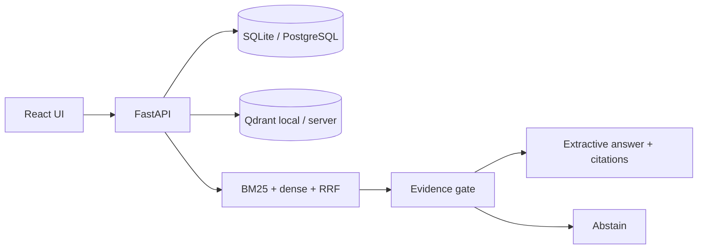

<a id="readme-top"></a>

<div align="center">

<picture>
  <source media="(prefers-color-scheme: dark)" srcset="docs/assets/banner-dark.svg">
  
</picture>

**Ask HR policy questions. Get answers you can verify.**

Evidence-first assistant for approved HR policies: hybrid retrieval, versioned sources, extractive citations, and honest abstention — offline by default, no paid API keys.

[Quick start](#quick-start) · [How it works](#how-it-works) · [Evaluation](#evaluation) · [Limitations](#security-privacy-and-limitations)

</div>

## Why this exists

| Before | After |
| --- | --- |
| Chatbots invent HR “rules” with no provenance | Answers are quoted passages with revision + effective date |
| Old PDFs linger in the index | Replacing a file supersedes vectors; past citations keep their snapshot |
| Silent failure when evidence is weak | Explicit abstention when nothing clears the evidence gate |

## Features

- Hybrid RAG: database BM25 + dense vectors (MiniLM) fused with RRF; PostgreSQL/SQLite is source of truth for every citeable hit
- Document library for PDF / DOCX / TXT / HTML with hostile-upload sandbox (timeout, zip-bomb, unterminated PDF image)
- Chat with inline citations, contradiction display, category filters, source viewer, version history
- Demo seed (≥5 synthetic policies + obsolete remote-work revision) and one-click reset
- Optional sparse-only fallback when embeddings or Qdrant are down (`/ready` → `degraded`)

## Quick start

> [!NOTE]
> Native path verified on Windows 11 with `uv` + `pnpm`. Docker Compose is present and verified in CI (`compose-smoke`); this authoring machine has no Docker.

```powershell
# Backend (API http://127.0.0.1:8101)
cd backend
uv sync
uv run python -m app.download_model   # first time only
uv run python -m app

# Frontend (http://127.0.0.1:5101) — new terminal
cd frontend
pnpm install
pnpm dev
```

| Service | URL |
| --- | --- |
| Web | http://127.0.0.1:5101 |
| API docs | http://127.0.0.1:8101/docs |
| Health | http://127.0.0.1:8101/health |

**60-second demo:** open Ask → *How many days of annual leave do employees get?* → expect an extractive answer citing **25 days of annual leave** with link `[1]` into the Leave policy. Ask *What is the sabbatical policy for pet iguanas?* → expect abstention.

Env vars: see [`.env.example`](.env.example). Loopback bind by default (`ALLOW_NETWORK_BIND` required for non-loopback).

## How it works



1. Parse uploads in a subprocess with caps; chunk by section/page.
2. Index terms in PostgreSQL/SQLite (BM25 stats keyed by `corpus_version`) and vectors in Qdrant.
3. Query: validate → category/audience filters → sparse + dense → RRF → evidence thresholds → quote or abstain.
4. Citations store snippet + sha256 + `document_version_id` so past answers survive supersede (HR-4).

Embedding model: `sentence-transformers/all-MiniLM-L6-v2` (Apache-2.0), CPU torch via `[[tool.uv.index]]` pytorch-cpu. Download: `make models`.

## Evaluation

Measured on the seeded synthetic corpus (`data/eval/questions.jsonl`) with the deterministic hash embedder used in unit tests. Re-run:

```powershell
cd backend
uv run python ../scripts/run_eval.py
```

Results are written to [`docs/EVAL.md`](docs/EVAL.md) / [`docs/EVAL_RESULTS.json`](docs/EVAL_RESULTS.json). Measured 2026-10-20 on **n=11** synthetic questions with the **hash** embedder used in unit tests (not a MiniLM production benchmark — perfect scores on this tiny fixture are expected):

| Mode | Recall@4 | MRR | Citation precision | Faithfulness | Abstention accuracy |
| --- | --- | --- | --- | --- | --- |
| hybrid | 1.00 | 1.00 | 1.00 | 1.00 | 1.00 |
| dense | 1.00 | 1.00 | 1.00 | 1.00 | 1.00 |

Method: gold titles/snippets in the JSONL; faithfulness = `sha256(snippet)` match; abstention accuracy covers `abstain` + `ambiguous` rows; dense vs hybrid via `retrieval_preference`.

## Testing

```powershell
cd backend; uv run ruff check .; uv run pytest -q
cd frontend; pnpm lint; pnpm typecheck; pnpm test; pnpm build
cd frontend; pnpm e2e   # Playwright: seeded ask + upload→index→cite
```

CI (GitHub Actions): backend Ruff + pytest (PostgreSQL service), frontend lint/tsc/vitest/build, `compose-smoke`. Check the Actions tab for the latest run status — do not treat this paragraph as a green badge.

## Repo layout

```
backend/     FastAPI, SQLAlchemy, Alembic, retrieval, parsers
frontend/    React + Vite + TanStack Query
data/demo/   Synthetic policies + manifest
data/eval/   Evaluation questions
scripts/     download_models, reconcile_index, run_eval
docs/        PRODUCT_SPEC, REVIEW_AMENDMENTS, GITHUB_METADATA, EVAL
compose.yaml web + api + postgres + qdrant (CI)
```

## Security, privacy and limitations

> [!IMPORTANT]
> Local demo · synthetic data. Loopback bind by default. Not legal advice. No multi-user auth in the MVP. Audience is a retrieval filter, not access control. Optional Ollama / cloud LLM grounding is not wired — MVP answers stay extractive.

License: pending owner decision.

GitHub About text / topics: [`docs/GITHUB_METADATA.md`](docs/GITHUB_METADATA.md).

<p align="right"><a href="#readme-top">↑ back to top</a></p>
