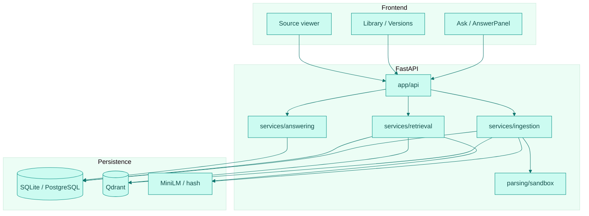
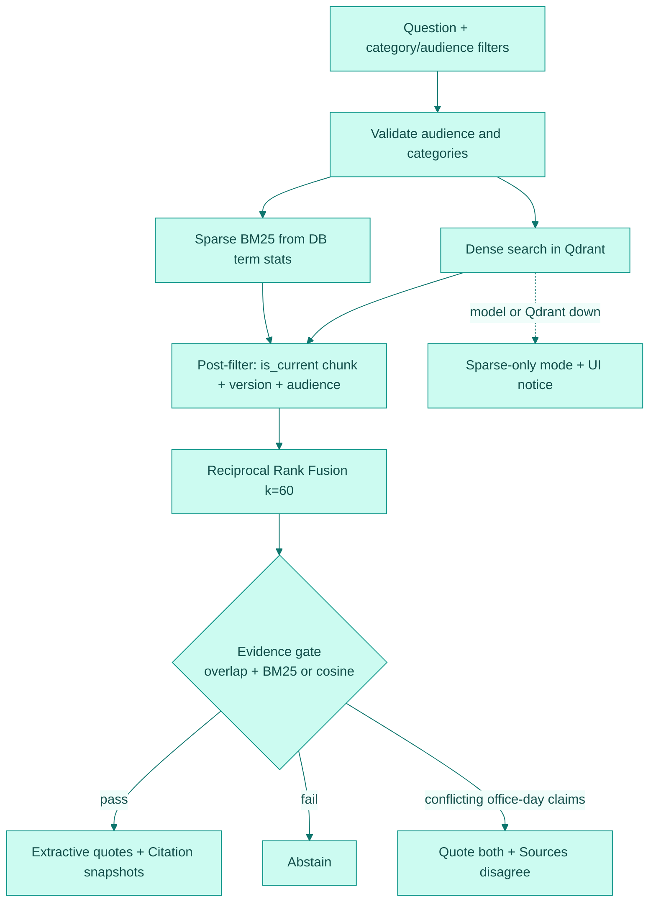

# Architecture — HR Policy Copilot

Evidence-first HR policy assistant: hybrid retrieval over versioned documents, extractive citations, and abstention when evidence is weak.

## Runtime topology

| Layer | Role | Default local | Compose / CI |
| --- | --- | --- | --- |
| React + Vite UI | Ask, library, source viewer, settings | `127.0.0.1:5101` | `web` service |
| FastAPI | Ingest, query, conversations, demo reset | `127.0.0.1:8101` | `api` service |
| Relational DB | Documents, versions, chunks, BM25 term stats, citations | SQLite under `data/` | PostgreSQL `5401` |
| Vector store | Dense chunk embeddings | Qdrant local path | Qdrant server `6301` |
| Embeddings | Query/document vectors | MiniLM on disk (`models/`) or `hash` for tests/eval | Same image cache |

Ports and loopback rules are binding in [`REVIEW_AMENDMENTS.md`](REVIEW_AMENDMENTS.md) (C-6, C-2).

## Component map

## Retrieval pipeline

Implemented in `backend/app/services/retrieval.py`, fused in `domain/fusion.py`, gated in `domain/evidence.py`, answered in `services/answering.py`.

Defaults (see `app/config.py`): `bm25_k1=1.5`, `bm25_b=0.75`, `rrf_k=60`, `evidence_min_overlap=3`, `evidence_min_bm25=1.0`, `evidence_min_cosine=0.55`, `max_passages=4`, `retrieval_candidate_limit=30`.

## Source of truth and versioning

1. **Database rows are authoritative.** Every dense or sparse hit is post-filtered against current chunks (`Chunk.is_current`, `DocumentVersion.is_current`, audience, optional category) before it can be cited (`post_filter_chunks`).
2. **Corpus version.** BM25 document frequency / average length live in `CorpusState.corpus_version` and related term tables; ingest bumps the version so multiple app processes share one index key ([HR-2](REVIEW_AMENDMENTS.md)).
3. **Supersede, do not erase history.** Replacing a file soft-deletes prior chunks/versions (`superseded_at`), removes superseded vectors, and keeps citation snapshots (`snippet`, `sha256`, `document_version_id`) so past answers remain inspectable ([HR-4](REVIEW_AMENDMENTS.md)).
4. **Reconcile.** `scripts/reconcile_index.py` / `app/reconcile.py` removes stale Qdrant points and restores missing current vectors.

## Ingestion and parsing threat boundary

Uploads go through size/extension checks, then `parse_in_subprocess` with timeout, page, and extracted-text caps. Hostile paths tested in-repo:

- Unterminated PDF inline image (`BI`…`ID` without `EI`) → fail
- Zip-bomb DOCX (uncompressed size / compression ratio caps) → fail

Pinned `pypdf` satisfies the advisory set listed in [REVIEW_AMENDMENTS.md](REVIEW_AMENDMENTS.md) HR-3.

## Failure modes

| Condition | Behavior |
| --- | --- |
| MiniLM missing or Qdrant unavailable | `/ready` → `degraded`; queries use sparse-only; UI notice |
| Evidence below thresholds | Explicit abstention (no invented prose) |
| Conflicting current policies | Both passages quoted; no automatic winner |
| Stale ingest job | Startup reaper marks `RUNNING` → `FAILED` |
| Non-loopback bind without flag | Startup refused |

## API surface (implemented)

| Method | Path | Purpose |
| --- | --- | --- |
| GET | `/health` | Liveness |
| GET | `/ready` | Readiness + degradation reason |
| GET | `/api/overview` | Corpus and retrieval status |
| GET/POST/DELETE | `/api/documents…` | Library, upload, replace version, delete |
| POST | `/api/query` | Ask → extractive answer or abstain |
| GET | `/api/conversations…` | Conversation history |
| POST | `/api/demo/reset` | Reseed synthetic policies |
| POST | `/api/demo/delete-all` | Wipe demo corpus |

OpenAPI: `http://127.0.0.1:8101/docs` when the API is running.

## Frontend responsibilities

- `Ask` + `AnswerPanel`: quotes, conflict, abstention, retrieval inspector
- `Library` / `Versions`: document list and revision history
- `Source`: highlighted cited passage for a version/chunk
- `Settings`: demo reset / delete-all; persistent “Local demo · synthetic data” banner when `APP_ENV=demo`

## Related docs

- Design constraints: [REVIEW_AMENDMENTS.md](REVIEW_AMENDMENTS.md)
- Decisions: [ENGINEERING_DECISIONS.md](ENGINEERING_DECISIONS.md)
- Evaluation: [EVALUATION.md](EVALUATION.md) (hash fixture + MiniLM tables)
- Security: [SECURITY.md](SECURITY.md)
- Release blockers: [RELEASE_READINESS.md](RELEASE_READINESS.md)
- Frontend: [../frontend/README.md](../frontend/README.md)
